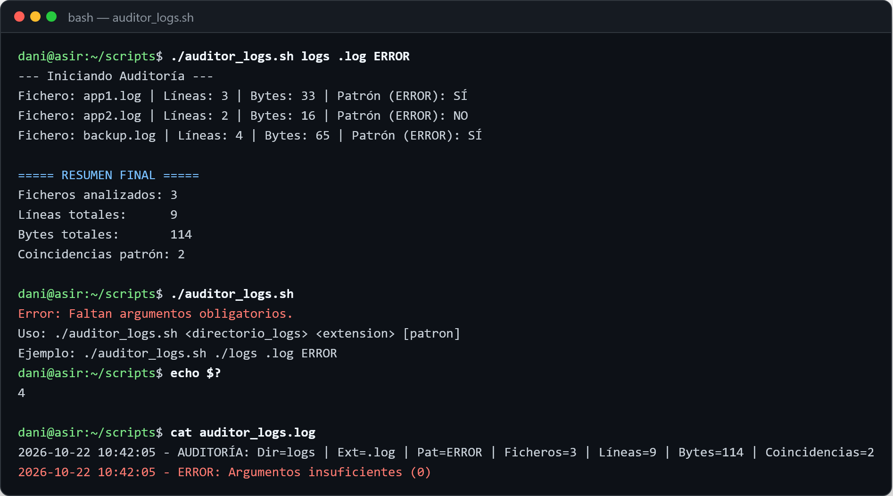
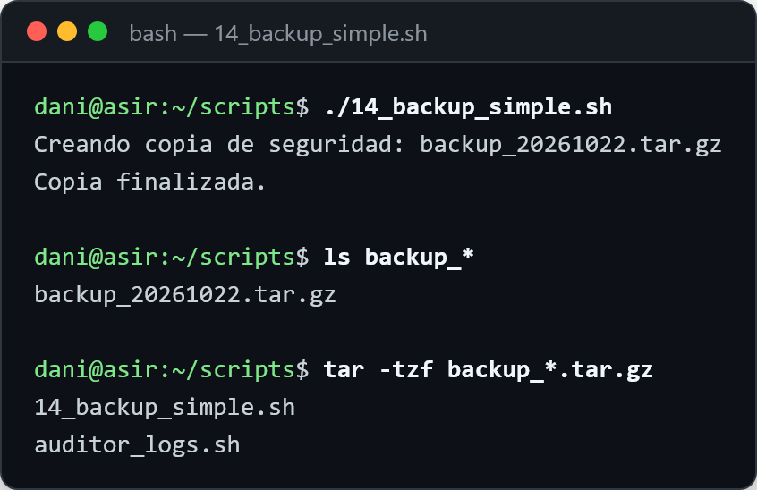

# Automatización con Bash

Scripts de Linux de 1.º de ASIR (Implantación de Sistemas Operativos): auditoría de logs, copias de seguridad y consulta de usuarios, programados con **cron**.

## Auditoría de logs
`auditor_logs.sh` cuenta las líneas y los bytes de cada log, busca un patrón y guarda un resumen. Si se usa mal, explica cómo llamarlo y sale con el código 4.

<p align="center"></p>

## Copias de seguridad
Comprime los ficheros con la fecha en el nombre y se programa cada noche:

```cron
30 2 * * * /home/dani/scripts/backup.sh >> /home/dani/logs/backup.log 2>&1
```

<p align="center"></p>

## Buenas prácticas
`set -euo pipefail`, rutas absolutas, códigos de salida claros, registro con fecha y bloqueo para que dos ejecuciones no se pisen.

---
Daniel Roca Martínez · [Currículum](https://daniroca5.gamer.gd/cv/)
